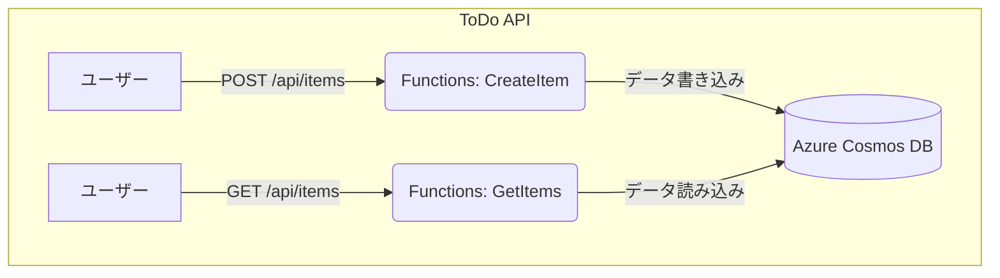

## **1. はじめに**
重要：このチュートリアルは、[Azure Functions を用いたWeb API作成　基礎(./azure-functions-http-basic-python.md)](./azure-functions-http-basic-python.md) の内容を理解していることを前提にしています。

このハンズオンでは、最新のv2プログラミングモデルを使用し、Azure FunctionsとAzure DocumentDBを連携させる方法を学びます。具体的には、**Pythonデコレーター（アノテーション）** を使って、ToDo項目を**登録する関数（POST）**と、**一覧を取得する関数（GET）**を直感的に実装します。

### **学習目標**

* ToDo APIのバックエンドとして必要なAzureリソース（DocumentDB, Functions）を作成できる。  
* VS Codeの拡張機能を使い、**v2モデルのAzure Functionsプロジェクト**を作成できる。  
* **Pythonデコレーター**を使い、**出力バインディング**と**入力バインディング**をコード内で直接定義できる。  
* PythonでAPIのロジックを記述し、**ローカルでテスト**した後にAzureへデプロイできる。

### **今回作成するシステムの構成**

## **2. 事前準備**

このハンズオンを開始する前に、以下の準備が完了していることを確認してください。

* 有効なサブスクリプションを持つAzureアカウント  
* Visual Studio Code  
* Python 3.9 以降（v2モデルで推奨）  
* **VS CodeにAzure Functions拡張機能がインストールされていること**  
* VS Codeに **Thunder Client** 拡張機能がインストールされているか、**Postman** などのAPIテストツールが利用できること

## **3. Azure DocumentDB リソースの作成**

最初に、ToDo項目の保存先となるAzure Cosmos DBを準備します。

1. **Azure Portalにサインイン**します。  
2. 「リソースの作成」からAzure DocumentDBを検索し、Azure DocumentDB (with MongoDB compatibility)を作成します。  
3. **アカウント作成画面**で以下の情報を入力します。  
   * **サブスクリプション** : 自分のサブスクリプションを選択。
   * **リソースグループ** : 選択または作成する  
   * **クラスター名**: 世界中で一意の名前（例: todo-api-cosmos-あなたの名前）  
   * **Freeレベル**: チェックを入れる (Freeレベルで作成できるDBの数は制限されています。)
   * **MongoDB バージョン**: 使用するバージョン（差し支えなければ最新のものを選ぶ）
   * **管理ユーザー名** : DBに接続、管理するユーザー名
   * **パスワード**: 管理ユーザーのパスワード。接続文字列に埋め込むので、差しさわりないものを設定。
   * **パスワードの確認**: 「**パスワード**」を再度入力  
4. **次へ:ネットワーク** をクリックし、ネットワーク接続に関する設定に進みます。
   * **パブリックアクセス（許可されているIPアドレス）** が選ばれていることを確認（外部からDBに直接接続しない場合は「プライベートアドレス」。ただし、PCで関数を実行してテストできない。）
   * **パブリックアクセス**と**ファイアウォール規制**の両方にチェックが入っていることを確認
   * **+0.0.0.0から255.255.255.255を追加する**をクリックし、確認の吹き出しで**「続行」**をクリックする（接続元を制限できる場合は、必要なアドレスだけ許可する）
5. **レビューと作成**をクリックし、確認画面で**「作成」**をクリックする。
6. リソースの作成が完了した後、接続文字列を取得します。
   * Azureポータル上でリソースを開き、[設定]→[接続文字列]にアクセスする。
   * グローバル読み取り/書き込み接続文字列 (現在このクラスター)の内容をコピーする。
     * この文字列には **<password>** という部分が含まれているので、これを作成時に指定したパスワードに置き換える。
  
## **4. Azure Functions プロジェクトの作成と設定**

次に、ToDo APIのベースとなるAzure Functionsプロジェクトを作成し、Cosmos DBへの接続情報を設定します。

### **4.1. VS Codeでv2モデルのプロジェクトを作成する**

1. PCの任意の場所に todo-api-v2 という名前で空のフォルダを作成し、そのフォルダをVS Codeで開きます。  
2. VS Codeのメニューで「表示」>「**コマンドパレット**」を選択します。（ショートカットキー: Ctrl+Shift+P または Cmd+Shift+P）  
3. コマンドパレットに Azure Functions と入力し、表示された一覧から「**Azure Functions: 新しいプロジェクトの作成...**」（Create New Project...）を選択します。  
4. プロンプト（画面上部に表示される質問）に順番に答えていきます。  
   * Select a folder...: **1で開いたtodo-api-v2フォルダ**を選択します。  
   * Select a language: **Python** を選択します。  
   * Select a programming model: 「**Model V2**」を選択します。（**これが最も重要です**）  
   * Select a Python interpreter...: ご自身のPCにインストールされているPython 3.9以降のバージョンを選択します。  
   * Select a template for your first function: 「**HTTP Trigger**」を選択します。  
   * Provide a function name: 「**http_trigger**」のままでEnterキーを押します。（後でコード全体を置き換えるため、名前は問いません）  
   * Select setting for authorization level: 「**Anonymous**」を選択します。  
5. プロジェクトの作成が完了すると、VS Codeのエクスプローラーにfunction\_app.pyというファイルを含むプロジェクト一式が自動で生成されます。v2モデルでは、このファイルにすべての関数を記述していきます。

### **4.2. プロジェクトにCosmos DBの接続情報を設定する**

1. エクスプローラーから local.settings.json ファイルを開きます。  
2. "Values" の中に、"CosmosDbConnectionString" というキーを追加し、**手順3.6で取得した接続文字列（パスワード設定済みであること）**を値として貼り付けます。  
```json
   {  
     "IsEncrypted": false,  
     "Values": {  
       "AzureWebJobsStorage": "",  
       "FUNCTIONS_WORKER_RUNTIME": "python",  
       "CosmosDbConnectionString": "AccountEndpoint=https://..."  
     }  
   }
```
## **5. ToDo APIの実装 (function_app.py)**
### コーディング

1. VS Codeのエクスプローラーで function_app.py を開きます。  
2. 既存のサンプルコードを**すべて削除**し、以下のコードに置き換えます。  
```python
import sys
from pathlib import Path

venv_path = Path(__file__).parent / "venv" / "Lib" / "site-packages"
sys.path.append(str(venv_path))

import logging
import os
import json
import pymongo
from bson import ObjectId

import azure.functions as func

# FunctionAppインスタンスを作成
app = func.FunctionApp(http_auth_level=func.AuthLevel.ANONYMOUS)

# MongoDBのObjectIdをJSONシリアライズ可能な文字列に変換するカスタムエンコーダー
class JSONEncoder(json.JSONEncoder):
    def default(self, o):
        if isinstance(o, ObjectId):
            return str(o)
        return json.JSONEncoder.default(self, o)

# POST /api/tasks : 新しいタスクを作成
@app.route(route="tasks", methods=["POST"])
def create_task(req: func.HttpRequest) -> func.HttpResponse:
    logging.info('Python HTTP trigger function processed a POST request to /tasks.')

    try:
        req_body = req.get_json()
    except ValueError:
        return func.HttpResponse("Invalid JSON format in request body.", status_code=400)

    # リクエストボディに必須の 'task' フィールドがあるかチェック
    if 'task' not in req_body:
        return func.HttpResponse("Bad request. The 'task' field is required.", status_code=400)

    try:
        connection_string = os.environ["CosmosDBConnectionString"]
        client = pymongo.MongoClient(connection_string)
        db = client["TodoDB"]
        collection = db["Tasks"]
        
        result = collection.insert_one(req_body)
        logging.info(f"Inserted document with id: {result.inserted_id}")
        
        # MongoDBが自動生成した_idをレスポンスに含めるため、req_bodyを更新
        req_body['_id'] = result.inserted_id
        
        return func.HttpResponse(
            body=json.dumps(req_body, cls=JSONEncoder),
            status_code=201, # 201 Created
            mimetype="application/json"
        )
    except Exception as e:
        logging.error(f"An error occurred: {e}")
        return func.HttpResponse("An error occurred while processing the request.", status_code=500)

# GET /api/tasks : 全てのタスクを取得
@app.route(route="tasks", methods=["GET"])
def get_tasks(req: func.HttpRequest) -> func.HttpResponse:
    logging.info('Python HTTP trigger function processed a GET request to /tasks.')

    try:
        connection_string = os.environ["CosmosDBConnectionString"]
        client = pymongo.MongoClient(connection_string)
        db = client["TodoDB"]
        collection = db["Tasks"]

        tasks = list(collection.find({}))
        
        return func.HttpResponse(
            body=json.dumps(tasks, cls=JSONEncoder),
            status_code=200,
            mimetype="application/json"
        )
    except Exception as e:
        logging.error(f"An error occurred: {e}")
        return func.HttpResponse("An error occurred while processing the request.", status_code=500)
```
## **6. ローカル環境でのテスト**

Azureにデプロイする前に、自分のPC上で関数が正しく動作するかを確認します。

1. **ローカルホストの開始**  
   * VS Codeのメニューから「ターミナル」>「新しいターミナル」を選択します。  
   * 開いたターミナルで、以下のコマンドを実行してローカルのFunctionsホストを開始します。  
     func start

   * ターミナルに、起動した関数のURL（例: http://localhost:7071/api/items）が表示されるのを確認します。  
2. **APIのテスト**  
   * **Thunder Client** や **Postman** などのAPIテストツールを使ってテストを行います。

   * #### **POSTリクエストでデータを登録する**      **2〜3回、内容を変えて実行し、データを複数件登録しておきましょう。**

     * **メソッド**: POST  
     * **URL**: http://localhost:7071/api/items  
     * **Headers**: Content-Type を application/json に設定します。  
     * **Body**: JSON を選択し、以下の内容を貼り付けます。  
      ```json
       {  
           "name": "牛乳を買う",  
           "description": "ローカルから登録",  
           "completed": false  
       }
      ```
     * リクエストを送信し、201 Created というステータスコードとメッセージが返ってくることを確認します。レスポンスのBodyにidが追加されていることも確認しましょう。

   * #### **GETリクエストでデータ一覧を取得する**

     * **メソッド**: GET  
     * **URL**: http://localhost:7071/api/items  
     * リクエストを送信し、レスポンスのBodyに登録したデータの一覧がJSON形式で表示されることを確認します。  
   * **Azure Portal**のCosmos DBのデータエクスプローラーでも、データがリアルタイムに保存されていることを確認できます。  
3. **ローカルホストの停止**  
   * テストが終わったら、func startを実行しているターミナルを選択し、Ctrl+Cを押してホストを停止します。

## **7. Azureへのデプロイとテスト**

ローカルでの動作確認が完了したら、APIをAzureにデプロイします。
   ( デプロイ先となるAzure Functions アプリケーションがない場合は作成してください。)

1. **VS CodeからAzureへデプロイ**  
   * VS CodeのアクティビティバーからAzureアイコンを選択します。  
   * RESOURCESビューでデプロイする対象のアプリケーションを表示し、右クリックします。
   * コンテキストメニューから、「Deploy to Function App...」 を選択します。

2. **デプロイした関数アプリに接続文字列を設定する**  
   * Azure Portalでデプロイした関数アプリのページを開き、左側メニューの「設定」セクションから「**環境変数**」を選択します。  
   * 「アプリケーション設定」タブが表示されていることを確認し、「**+ 追加**」をクリックします。  
   * **名前**の欄に CosmosDbConnectionString、**値**の欄に（手順3.8でコピーしたCosmos DBのプライマリ接続文字列）を入力し、「OK」と「保存」をクリックして変更を適用します。  
3. **デプロイしたAPIのテスト**  
   * Azure Portalでデプロイした関数アプリのページを開き、「関数」からcreate_itemまたはget_itemsを選択し、「関数のURLの取得」でベースURLを取得します。エンドポイントは /api/items です。  
   * ローカルテストと同様にAPIテストツールを使って、今度はURLを**デプロイ先のURL**に変更してPOSTとGETのリクエストを送信し、動作を確認してください。

## **8. まとめ**

このハンズオンでは、最新のv2プログラミングモデルを使い、Pythonデコレーターで直感的にバインディングを定義することで、Cosmos DBと連携する本格的なToDo APIを効率的に構築しました。また、Azureへデプロイする前にローカル環境でテストを行う、基本的な開発サイクルも体験できました。
