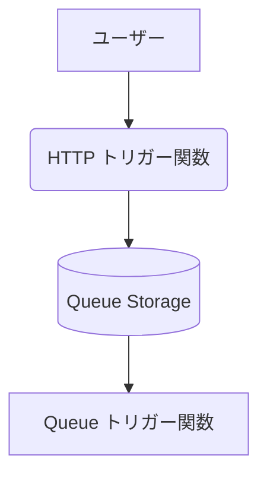

# **Azure Queue Storage 基礎 ～ 非同期処理で実現する、応答性が高く堅牢なWebシステム構築 ～**

## **1. はじめに**

### **本ハンズオンの目的**

本ハンズオンでは、Azure Queue Storage を利用して、応答性が高いWebシステムを構築する基本的な手法を学習する。

* **【本演習のゴール】:** 非同期処理の基本を実装し、キューの必要性を理解する。

### **キューの必要性 - なぜ「順番待ち」の仕組みが重要なのか？**

Webシステムを開発していると、完了までに時間がかかる「重い処理」に直面することがあります。例えば、以下のような処理です。

* **動画の変換:** ユーザーがアップロードした動画を、スマートフォン用やPC用など複数の形式に変換する。  
* **レポートの生成:** 大量のデータから分析レポートを作成する。  
* **メールの大量送信:** 何千人ものユーザーに一斉にメールマガジンを送信する。  
* **ECサイトの注文処理:** 支払い、在庫の更新、注文確認メールの送信、配送システムへの連携など、複数の処理を一度に行う。

これらの処理を、ユーザーからのリクエストに応じてその場で実行する方式を**同期処理**と呼びます。しかし、同期処理には大きな問題があります。

#### **問題点：同期処理の限界（レストランの例）**

人気のレストランで、一人の店員が「注文受付」「調理」「配膳」「会計」の全てを担当している状況を想像してください。

1. Aさんが注文すると、店員はAさんの料理が完成し、会計が終わるまで他の誰の対応もできません。  
2. その間、BさんやCさんは入り口でただひたすら待ち続けることになります。

これが同期処理のイメージです。Webシステムでは、ユーザーの画面がフリーズし、ユーザーは処理が終わるまで何もできずに待たされることになります。これではユーザー体験（UX）は非常に悪くなります。

#### **解決策：非同期処理とキューの活用**

この問題を解決するのが、**非同期処理**と**キュー**です。先ほどのレストランの例えを、役割分担を導入して改善してみましょう。

1. 受付係（**Web API**）は、来店したお客様の注文を次々と受け付け、整理券（**メッセージ**）を渡して席にご案内します。お客様はすぐに「注文は受け付けられた」と安心できます。  
2. 受付係は、受け付けた注文票を「順番待ちの列（**キュー**）」に置きます。  
3. 厨房のシェフ（**ワーカー**）は、自分のペースでキューから注文票を1枚ずつ取り出し、調理に専念します。

このように、**すぐに終わる処理（受付）**と**時間のかかる処理（調理）**を分離し、その間に「キュー」を挟むことで、システム全体がスムーズに流れるようになります。ユーザー（お客様）を待たせることなく、システムは裏側で効率的に重い処理を実行できるのです。

#### **キューのメッセージを処理する様々な方法**

キューに届いたメッセージ（タスク）を処理する「ワーカー」の実装方法は、主に2つのアプローチがあります。

1. **イベント駆動型（サーバーレス） - Azure Functions**  
   * **特徴:** キューに新しいメッセージが追加されたことを**きっかけ（イベント）**として、自動的にプログラムが実行されます。  
   * **利点:** メッセージがない時はプログラムが待機しているため、コストを非常に低く抑えられます。サーバーの管理が不要で、メッセージの量に応じて自動で処理能力を調整（スケール）してくれます。多くのモダンなシステムで採用されている効率的な方法です。  
2. **常時実行型 - Azure App Service (WebJobs) や仮想マシン**  
   * **特徴:** ワーカーとなるプログラムを常に起動しておき、プログラム自身が定期的に「新しいメッセージはありますか？」とキューを確認（ポーリング）しにいきます。  
   * **利点:** プロセスの挙動を細かく制御したい場合や、常に稼働し続ける必要がある複雑な処理に適しています。  
   * **本ハンズオンでのアプローチ:** 今回の演習では、Azure Functions の Queue トリガーを用いて、キューとワーカーが連携する基本的な仕組みを直接的に理解することができます。

本ハンズオンでは、Azure Functions の HTTP トリガーと Queue トリガーを組み合わせて非同期処理を実現するシステムを構築し、この中核技術として **Azure Queue Storage** を活用します。

### **準備**

* Azure サブスクリプション  
* Visual Studio Code  
* Python 3.8 以上  
* Azure Functions Core Tools (func CLI)  
* Postman、curl等のAPIリクエストツール

## **2. ハンズオン演習 - 非同期処理による応答性向上の基本 (60分)**

この演習では、シンプルな「Webアンケート受付システム」を構築します。このシステムは、2つの主要なコンポーネントで構成されています。

1. **HTTP トリガー関数（受付役）:** ユーザーからのアンケート投稿を受け付け、その内容をすぐにキューに送信します。そして、重い処理を待たずに即座に「受け付けました」という応答をユーザーに返します。  
2. **Queue トリガー関数（集計役）:** キューに新しいアンケートデータが追加されると、自動的に起動してメッセージを取り出し、データベースへの保存や集計といった（今回はシミュレーションとしての）時間のかかる処理を実行します。

この演習を通して、2つの関数がキューを介してどのように連携し、ユーザー体験を向上させるかを具体的に学びます。

**目標:** HTTP トリガー関数と Queue トリガー関数をキューで分離（デカップリング）する基本構成を実装し、その効果を理解する。

**シナリオ:** ユーザーからのアンケート投稿を受け付け、時間のかかる集計処理をバックグラウンドで実行し、ユーザーには即座に完了応答を返す「Webアンケート受付システム」を構築する。

### **ステップ1: Azureリソースの準備 (10分)**

1. **Azure Portal** にサインインする。  
2. **リソースグループ**を新規作成します。名前は queue-practice とします。  
3. リソースグループ内に**ストレージアカウント**を新規作成する。  
   * **「基本」タブ:**  
     * **ストレージアカウント名:** queuestorage[受講者名や学籍番号など] のように、世界で一意になる名前を付けます。（例: queuestorageyamada）  
     * **パフォーマンス:** Standard  
     * **冗長性:** LRS (ローカル冗長ストレージ) を選択します。  
   * **その他のタブ:** 「詳細設定」や「ネットワーク」などのタブは、この演習ではデフォルト設定のままで問題ありません。  
   * **確認と作成:** 画面下部の「確認」または「確認および作成」ボタンをクリックし、内容に問題がなければ最後に「作成」をクリックしてデプロイを開始します。  
4. デプロイ完了後、作成したストレージアカウントのメニューから「キュー」を選択し、新しいキューを作成する。  
   * **キュー名:** survey-queue  
5. ストレージアカウントのメニューから「アクセスキー」を選択し、**接続文字列 (Connection String)** をコピーする。これはプログラムからAzure Storageに接続するために使用される。

### **ステップ2: Azure Functions プロジェクトの作成 (5分)**

ローカルで Azure Functions を実行するためのプロジェクトを作成する。

1. ローカルPCに作業用フォルダ（例: azure-handson）を作成する。  
2. 仮想環境を作成して有効化する。  
   ```
   python -m venv venv
   venv\Scripts\activate
   ```
3. ターミナルで azure-handson フォルダに移動し、以下のコマンドを実行してAzure Functions Pythonプロジェクトを初期化する。  
   ```
   func init --python
   ```

4. 依存パッケージをインストールする。  
   ```
   pip install azure-functions azure-storage-queue
   ```
6. `requirements.txt` を開き、以下の内容に書き換える。  
   ```
   azure-functions
   azure-storage-queue
   ```


### **ステップ3: HTTP トリガー関数 (受付役) の実装 (15分)**

ユーザーからのリクエストを受け取り、キューにメッセージを追加するHTTPトリガー関数を実装する。

1. `function_app.py` を開き、以下のコードを記述する。  
   ```python
   # function_app.py
   import azure.functions as func
   import json
   import base64
   from azure.storage.queue import QueueClient

   app = func.FunctionApp()

   @app.route(route="survey", methods=[func.HttpMethod.POST])
   def submit_survey(req: func.HttpRequest) -> func.HttpResponse:
       try:
           body = req.get_json()
           print('アンケートリクエスト受信:', body)

           # 使用するAzure Storageの接続文字列に置換
           CONNECTION_STRING = "ここにAzure Storageの接続文字列を貼り付け"
           QUEUE_NAME = "survey-queue"

           # 1. QueueClientのインスタンスを作成
           queue_client = QueueClient.from_connection_string(CONNECTION_STRING, QUEUE_NAME)

           # 2. キューが存在しない場合は作成
           queue_client.create_queue()

           # 3. リクエストボディをJSON文字列に変換し、Base64エンコード
           message_text = json.dumps(body)
           base64_message = base64.b64encode(message_text.encode('utf-8')).decode('utf-8')

           # 4. キューにメッセージを送信
           queue_client.send_message(base64_message)
           print(f'メッセージをキューに追加: {message_text}')

           # 5. ユーザーに受付完了の応答を返す
           return func.HttpResponse(
               json.dumps({"message": "アンケートの集計処理を受け付けました。"}),
               status_code=202,
               mimetype="application/json"
           )

       except Exception as error:
           print(error)
           return func.HttpResponse(
               json.dumps({"message": "サーバーエラーが発生しました。"}),
               status_code=500,
               mimetype="application/json"
           )
   ```
2. CONNECTION_STRING の値を、ステップ1でコピーした自身の接続文字列に置換する。

### **ステップ4: Queue トリガー関数 (集計役) の実装 (20分)**

キューを監視し、メッセージが存在すれば自動的に起動して処理するQueueトリガー関数を実装する。

1. `function_app.py` に以下のQueueトリガー関数を追加する。  
   ```python
   import time

   @app.queue_trigger(arg_name="msg", queue_name="survey-queue", connection="AzureWebJobsStorage")
   def process_survey(msg: func.QueueMessage) -> None:
       # Base64デコードして元のJSON文字列に復元
       message_text = base64.b64decode(msg.get_body().decode('utf-8')).decode('utf-8')
       print(f'[処理開始] メッセージ受信: {message_text}')

       # 時間のかかる集計処理のシミュレーション
       time.sleep(3)  # 3秒待機

       print('[処理完了] メッセージを削除しました。')
   ```
2. `local.settings.json` の `AzureWebJobsStorage` に、ステップ1でコピーした接続文字列を設定する。  
   ```json
   {
     "IsEncrypted": false,
     "Values": {
       "AzureWebJobsStorage": "ここにAzure Storageの接続文字列を貼り付け",
       "FUNCTIONS_WORKER_RUNTIME": "python"
     }
   }
   ```

### **ステップ5: 動作確認 (10分)**

1. **仮想環境の有効化:** ターミナルで仮想環境が有効になっていることを確認する。有効になっていない場合は以下のコマンドを実行する。  
   ```
   .venv\Scripts\activate
   ```
2. **関数の起動:** azure-handson フォルダのターミナルで以下のコマンドを実行する。  
   ```
   func start
   ```
   .venv\Scripts\activate
   ```
2. **関数の起動:** azure-handson フォルダのターミナルで以下のコマンドを実行する。  
   ```
   func start
   ```
2. **リクエストの送信:** Postman等のツールを使用し、以下の設定でHTTPトリガー関数にリクエストを送信する。**後の演習課題で使用するため、この段階でemailフィールドを含めておきます。**  
   * **Method:** POST  
   * **URL:** http://localhost:7071/api/survey  
   * **Body (raw, JSON):**  
    ```
     {  
         "user": "Taro Yamada",  
         "rating": 5,  
         "comment": "Good",  
         "email": "taro@example.com"  
     }
    ```
3. **結果の確認:**  
   * **APIクライアント:** リクエストを送信すると、Postmanには**即座に**「アンケートの集計処理を受け付けました。」という応答が返されることを確認する。  
   * **Azure Portalでの確認 (ここが重要):**  
     1. リクエスト送信後、すぐにAzure Portalを開き、ストレージアカウントの survey-queue を表示します。  
     2. 画面上部にある「更新」ボタンをクリックすると、キュー内のメッセージが一覧で表示されます。ID、メッセージテキスト、挿入時刻、デキュー数などの列があることを確認してください。  
     3. 一覧に新しいメッセージが1件追加され、メッセージテキストに送信したJSONデータが表示されていることを確認します。これが、HTTPトリガー関数がメッセージをキューに追加した証拠です。  
     4. そのまま数秒待ってから再度「更新」ボタンをクリックすると、一覧からメッセージが消えていることを確認します。これは、Queueトリガー関数がメッセージを取得・処理し、キューから削除したことを意味します。  
   * **関数のログ:** `func start` を実行しているターミナルに、リクエストから**少し遅れて**「[処理開始]...」「[処理完了]...」というログが出力されることを確認する。

この一連の動作を確認することで、HTTPトリガー関数がキューにタスクを預け、Queueトリガー関数がそれを非同期に処理している流れを視覚的に追跡できます。

## **3. まとめ**

本ハンズオンでは、以下の項目について学習した。

* **応答性の向上:** キューを用いた処理の非同期化によるユーザーエクスペリエンスの改善。  
* **システムの分離（デカップリング）:** HTTPトリガー関数とQueueトリガー関数を分離することによる、開発・運用・スケールにおける独立性の確保。

これらの技術要素は、現代的なWebシステム開発において重要な概念である。
